I dette kurset lager du din første app i Altinn Studio. Du starter med en tom app og ender med et skjema med to sider.
Senere kurs i serien bygger videre på appen du lager her.

Etter kurset kan du

- opprette en app og endre informasjonen om den
- dele endringene dine, slik at andre kan se dem og du kan publisere dem
- bygge en side med bilde og tekst
- lage en enkel datamodell
- bygge en skjemaside med felter som er koblet til datamodellen

## Dette skal du lage

Sogndal kommune vil ønske nye innbyggere velkommen og samtidig samle inn noen opplysninger om dem. Når noen melder
flytting til kommunen, skal de få et enkelt skjema i Altinn.

Skjemaet har to sider:

1. En velkomstside med logoen til kommunen og en kort velkomsttekst.
2. En side der innflytteren fyller ut opplysninger om seg selv og sender inn skjemaet.

Du er tjenesteutvikler i kommunen. Underveis i kurset får du en bestilling fra kommunen, og den skal du gjøre om til en
datamodell og et skjema.

## Opprett en ny app

1. Klikk på **Opprett ny app** på dashbordet.
2. Under **Eier** velger du organisasjonen din.
   >*Hvis du lager appen på din egen bruker, kan du ikke publisere den til et testmiljø senere.*
3. Skriv inn et navn under **Navn**, for eksempel `velkommen-til-sogndal`.
   >*Navnet må være unikt i organisasjonen din. Altinn Studio bruker det også i nettadressen til tjenesten når den er
   publisert. Du kan ikke endre navnet senere.*
4. Under **Velg appversjon** velger du **Altinn App v9 (preview)**. Dette kurset er skrevet for apper på versjon 9.
5. Klikk på **Opprett app** og vent til appen er opprettet.

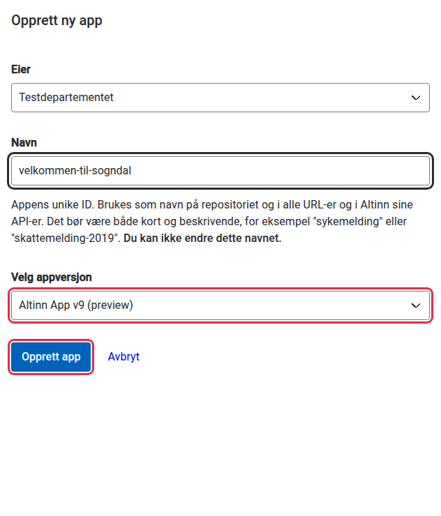

## Endre informasjonen om appen

Når appen er opprettet, kommer du til oversiktssiden for appen. Her ser du dette:

- **Menylinjen**: Her går du til verktøyene, som **Utforming**, **Datamodell** og **Språk**. Under menylinjen finner du
  blant annet **Innstillinger**, **Forhåndsvis** og **Del dine endringer**.
- **Appens tittel**: Brukeren ser tittelen inne i appen og i innboksen i Altinn. Til å begynne med er tittelen det
  samme som navnet på appen.
- **Miljøer**: Her ser du hvilke miljøer organisasjonen din kan publisere apper til, for eksempel testmiljøet TT02 og
  produksjonsmiljøet.
- **Kom i gang**: Her finner du dokumentasjonen for Altinn Studio.
- **Nyheter**: Her publiserer vi informasjon om ny funksjonalitet.

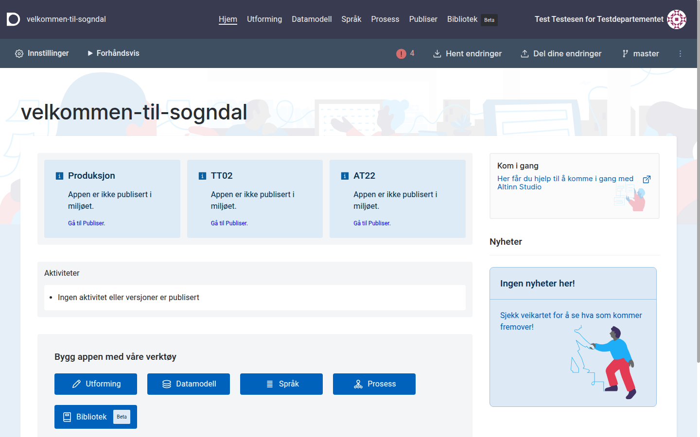

### Se hva som mangler

Ved siden av **Hent endringer** står det et varselsymbol med et tall. Tallet viser hvor mange feil og advarsler appen
har. Klikk på symbolet for å åpne **Valideringsfeil og advarsler**.

En ny app mangler navn på nynorsk, beskrivelse og kontaktinformasjon. Du må rette opp feilene før du kan publisere
appen. Advarslene kan du se bort fra i dette kurset. Klikk på en feil for å gå rett til stedet der du retter den.

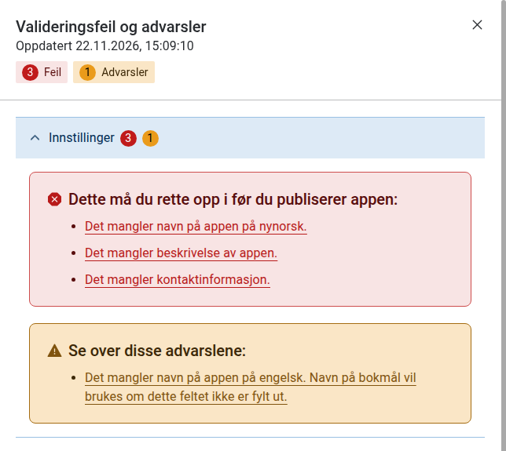

### Legg inn navn, beskrivelse og kontaktinformasjon

1. Klikk på **Innstillinger** under menylinjen. Fanen **Om appen** åpnes.
2. Under **Navn på appen** skriver du inn et navn som brukerne forstår, for eksempel «Velkommen til Sogndal kommune».
   Klikk på fanen **Nynorsk** og skriv inn navnet på nynorsk, for eksempel «Velkomen til Sogndal kommune».
3. Under **Kort beskrivelse av appen** beskriver du hvem som skal bruke appen, og hva de skal bruke den til. Skriv
   beskrivelsen både på **Bokmål** og **Nynorsk**.
4. Under **Legg til kontaktinformasjon** klikker du på **Legg til ny kontakt**. Fyll ut **E-postadresse** og
   **Tittel som beskriver hva det gjelder**, for eksempel «Kontakt kommunen», og klikk på **Lagre**.
5. Klikk på **Lagre** nederst på siden.
6. Klikk på **Til Hjem** for å gå tilbake til oversikten.

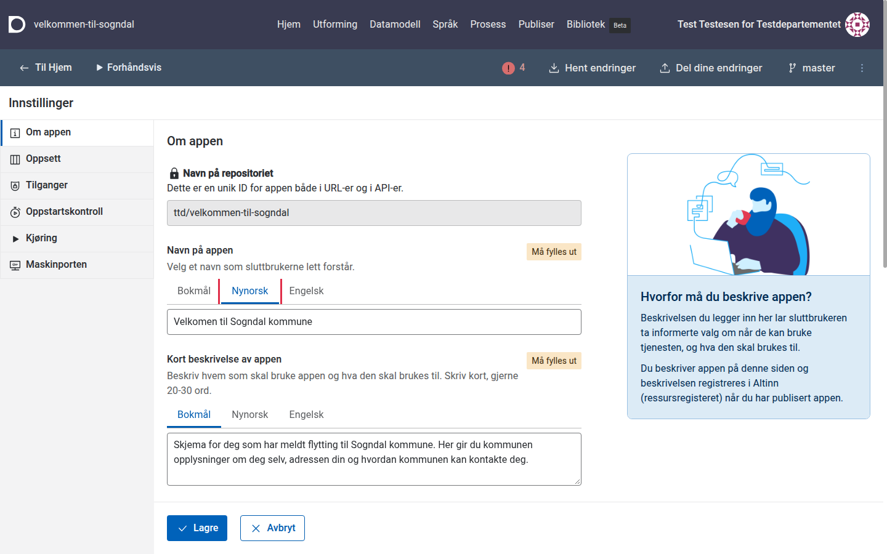

Tittelen på oversiktssiden er nå oppdatert. Varselsymbolet viser bare advarslene om at navn og beskrivelse mangler på
engelsk. Da bruker Altinn Studio teksten på bokmål.

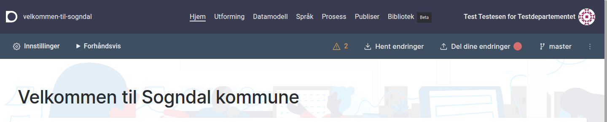

## Lagre og dele endringer

Når du jobber med en app i Altinn Studio, er det to områder:

- **Ditt eget område**: Altinn Studio lagrer alle endringene dine her automatisk. Det er bare du som ser dem.
- **Appens sentrale område**: Alle som jobber med appen, ser endringene her. Når du publiserer appen, bygger Altinn
  Studio den herfra.

Du må dele endringene dine til appens sentrale område før du kan publisere dem. Når du har endringer du ikke har delt,
står det en rød prikk ved **Del dine endringer**.

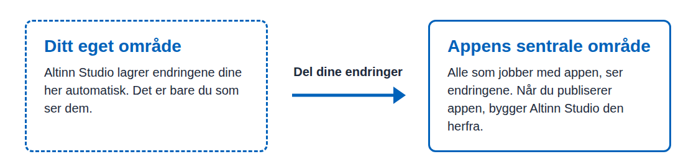

### Del endringene

1. Klikk på **Del dine endringer** under menylinjen.
2. Vil du se hva du har endret, klikker du på **Se siste endringer**. Lukk vinduet når du er ferdig.
3. Beskriv endringene under **Beskriv endringene som er gjort**, for eksempel «La inn navn, beskrivelse og
   kontaktinformasjon for appen».
4. Klikk på **Del endringer**.

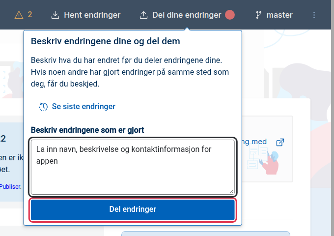

## Lage velkomstsiden

Du starter med velkomstsiden. Den skal ha logoen til kommunen og en kort velkomsttekst.

### Åpne Utforming

1. Klikk på **Utforming** i menylinjen.
2. Klikk på **Utform** på kortet for oppgaven **Task_1**. Oppgaven er utfyllingsoppgaven, der brukeren fyller ut
   skjemaet.
3. Slå på bryteren **Prøv nytt design** øverst til høyre. Dette kurset bruker det nye designet for å legge til
   komponenter.

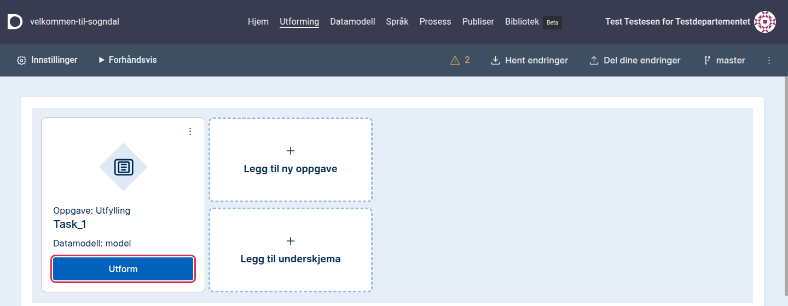

Utforming har tre kolonner:

- **Oppsett**: Her legger du til sider og komponenter i skjemaet.
- **Innstillinger**: Her setter du opp siden eller komponenten du har valgt.
- **Forhåndsvisning**: Her ser du hvordan siden ser ut for brukeren.

{}
Forhåndsvisningen i Altinn Studio er midlertidig skrudd av. Du ser bare en melding om dette i stedet for skjemaet.
{}

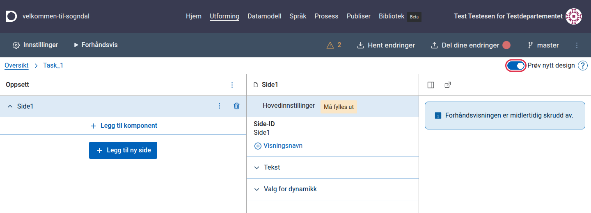

### Legg til et bilde

1. Klikk på siden **Side1** for å åpne den, og klikk på **Legg til komponent**.
   Du ser en liste med de vanligste komponentene.

   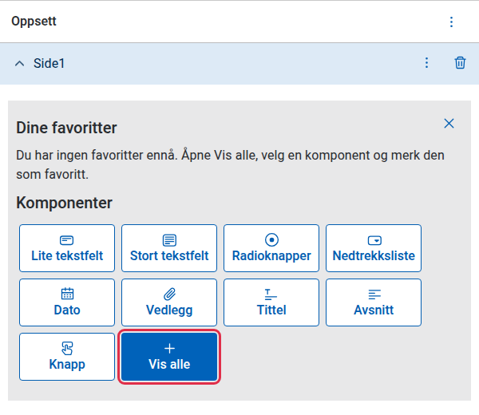

2. Bilde står ikke i listen. Klikk på **Vis alle** og søk etter «Bilde».
3. Klikk på **Bilde** under **Informasjon**, og klikk på **Legg til**.

   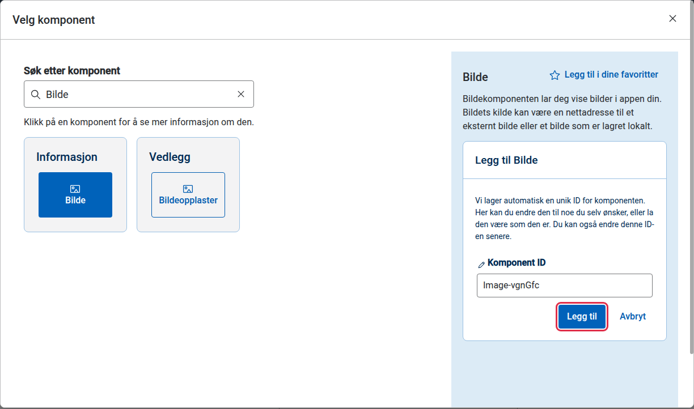

4. Under **Valg for bilde** klikker du på fanen **Lim inn en URL**. Klikk på **Lim inn bildeadressen (URL-en)** og lim
   inn denne adressen:
   https://docs.altinn.studio/nb/altinn-studio/v9/getting-started/development/basic-form/kommune-logo.png
5. Klikk utenfor feltet for å lagre adressen.

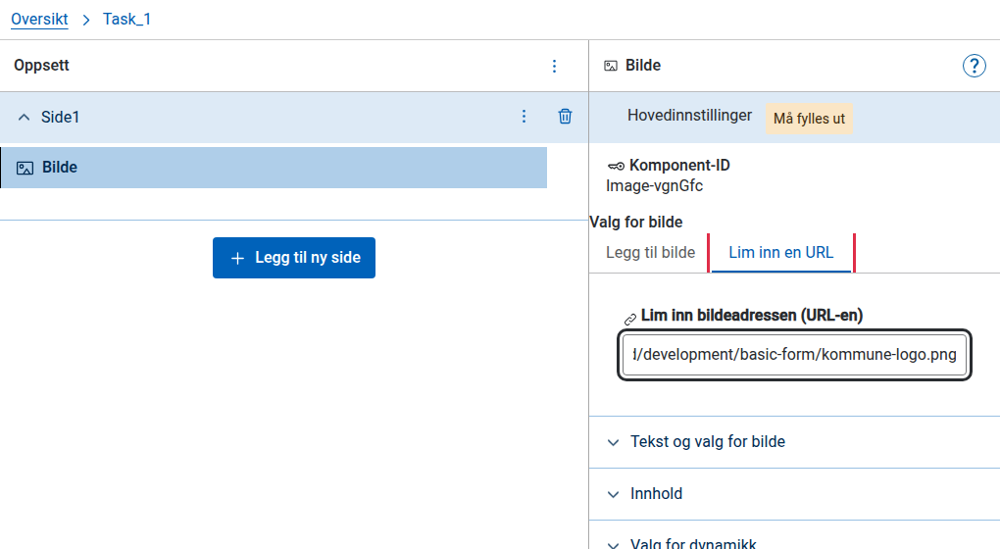

### Legg til et avsnitt

1. Hold musepekeren rett under komponenten **Bilde** i **Oppsett**. Det dukker opp en **+**-knapp.
2. Klikk på **+** og velg **Avsnitt**.

   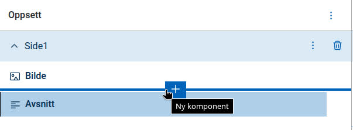

3. Klikk på **Ledetekst** under innstillingene for avsnittet.
4. Skriv inn velkomstteksten under **Skriv tekst**, for eksempel «Vi har registrert at du har meldt flytting til
   Sogndal kommune - velkommen til oss!».
5. Klikk på **Lagre**.

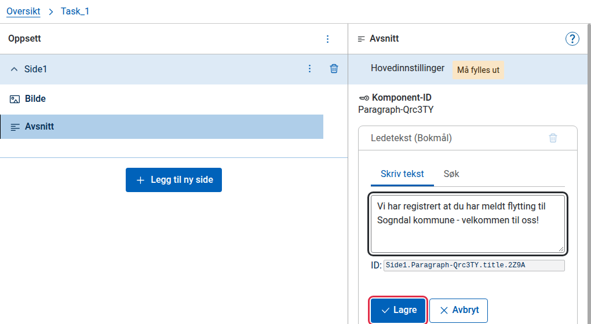

Velkomstsiden har nå et bilde og et avsnitt. I **Oppsett** ser du teksten i avsnittet.

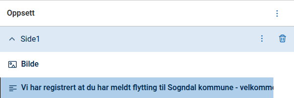

## Sette opp datamodellen

En datamodell er en slags innholdsfortegnelse for skjemaet. Med datamodellen bestemmer du _hva_ du vil hente inn av
data, og _hvordan_ dataene skal se ut.

For et enkelt skjema er det ofte en direkte kobling mellom et felt i datamodellen og et felt i skjemaet. For mer
avanserte skjemaer kan datamodellen og skjemaet være ganske forskjellige.

Når du oppretter en app, følger det med en datamodell som heter `model`, med noen eksempelfelter. Du kan slette
feltene, gi dem nye navn og legge til egne felter.

Du kan lese mer i [veiledningen om datamodellering i Altinn Studio]().

### Krav fra kommunen

Kommunen vil i første omgang samle inn disse opplysningene om innflyttere:

- **Personinformasjon**: fullt navn og alder
- **Adresse**: gateadresse, postnummer og poststed
- **Kontaktinformasjon**: e-postadresse og telefon

Du skal lage en gruppe for hver av de tre typene opplysninger. I datamodellen er en gruppe et objekt. Lag denne
datamodellen:

| Gruppe (objekt) | Felt          | Type    |
|-----------------|---------------|---------|
| `person`        | `fullt_navn`  | Tekst   |
| `person`        | `alder`       | Heltall |
| `adresse`       | `gateadresse` | Tekst   |
| `adresse`       | `postnummer`  | Tekst   |
| `adresse`       | `poststed`    | Tekst   |
| `kontaktinfo`   | `epost`       | Tekst   |
| `kontaktinfo`   | `telefon`     | Tekst   |

### Lag datamodellen

1. Klikk på **Datamodell** i menylinjen. Sjekk at datamodellen `model` er valgt.

   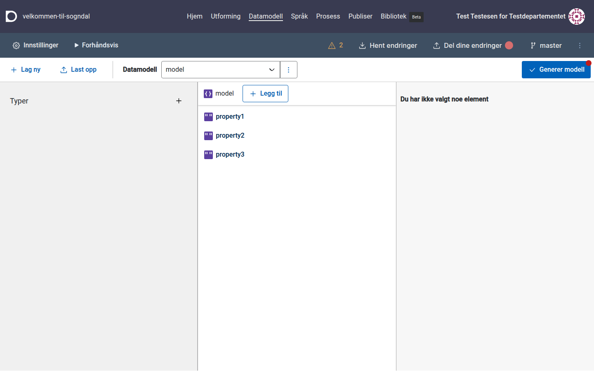

2. Slett eksempelfeltene. Hold musepekeren over feltet, klikk på søppelbøtteikonet og bekreft at du vil slette feltet.

   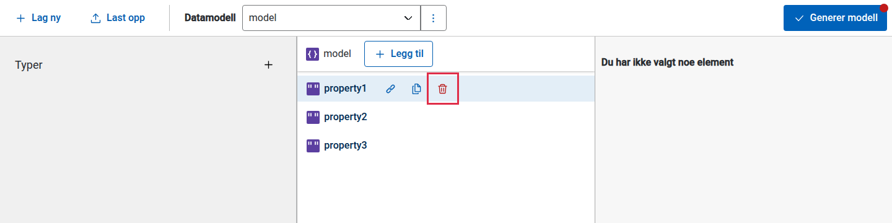

3. Klikk på **Legg til** øverst og velg **Objekt**.
4. Under **Egenskaper** til høyre endrer du **Navn** til `person`.
5. Klikk på **Legg til felt** ved siden av gruppen `person` og velg **Legg til tekst**.

   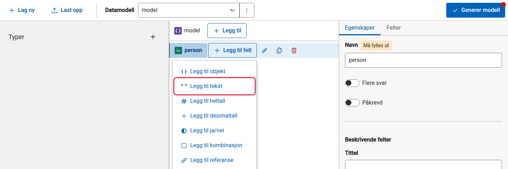

6. Endre **Navn** på det nye feltet til `fullt_navn`.
7. Legg til resten av gruppene og feltene fra tabellen på samme måte. Feltet `alder` legger du til med
   **Legg til heltall**.
8. Klikk på **Generer modell**. Altinn Studio lager filene appen trenger for datamodellen, og viser en melding når det
   er gjort.

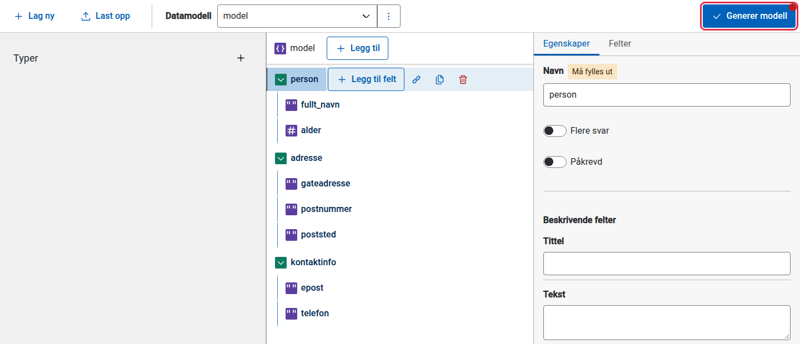

### Dele endringene

Del endringene dine på samme måte som tidligere. Klikk på **Del dine endringer**, beskriv endringene og klikk på
**Del endringer**.

## Utforme skjemasiden

Nå skal du bygge selve skjemaet. Du gjør det nesten på samme måte som da du laget velkomstsiden.

Klikk på **Utforming** i menylinjen, og klikk på **Utform** på kortet for oppgaven **Task_1**.

### Lag en ny side

1. Klikk på **Legg til ny side**. Altinn Studio legger til en ny side som heter «Side2».
2. Klikk på **Side-ID** under innstillingene for siden, og endre den til `om-innflytter`. Klikk på **Lagre**.
3. Klikk på **Visningsnavn** og skriv inn «Om innflytter» under **Skriv tekst**. Klikk på **Lagre**.

Altinn Studio legger automatisk til komponenten **Navigasjonsknapper** på begge sidene. Da kan brukeren bla mellom
sidene med knappene **Neste** og **Forrige**.

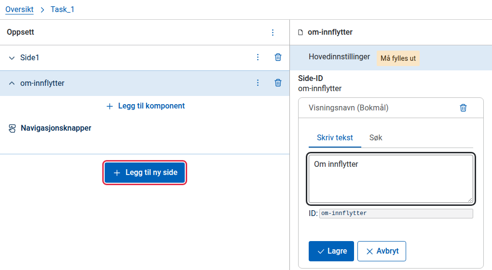

### Legge til det første skjemafeltet

Det første feltet skal samle inn navnet til innflytteren. Til det bruker du komponenten **Lite tekstfelt**, der brukeren
skriver inn en kort tekst på én linje.

1. Sjekk at siden **om-innflytter** er åpen, og klikk på **Legg til komponent**.
2. Klikk på **Lite tekstfelt**.

Komponenten står nå på siden, foran navigasjonsknappene. Den mangler en ledetekst og en kobling til datamodellen.

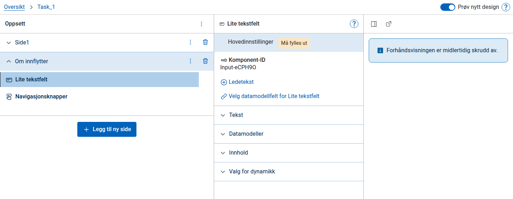

### Legge inn ledeteksten

Ledeteksten står over feltet og forteller brukeren hva de skal fylle inn.

Altinn Studio lagrer alle tekstene i appen i en egen tekstfil, og hver tekst får en unik ID. Komponenten peker på
ID-en, ikke på selve teksten. Derfor kan du bruke samme tekst flere steder, endre teksten uten å endre komponenten og
oversette teksten til nynorsk og engelsk under **Språk** i menylinjen.

1. Sjekk at komponenten **Lite tekstfelt** er valgt, og klikk på **Ledetekst**.
2. Skriv «Fullt navn» under **Skriv tekst**. Altinn Studio lager ID-en for teksten automatisk.
3. Klikk på **Lagre**.

Vil du bruke en tekst som allerede finnes i appen, klikker du på **Søk** og velger teksten fra listen.

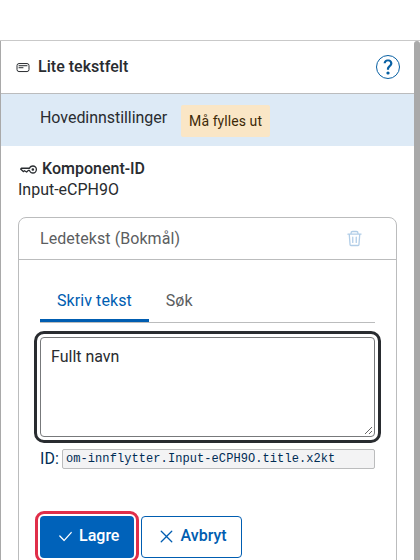

### Knytte feltet til datamodellen

Når brukeren fyller ut skjemaet, må appen lagre svaret et sted. Det er datamodellen som bestemmer hvor. Du knytter hvert
skjemafelt til et felt i datamodellen, slik at svaret havner på riktig sted. Navnet til innflytteren skal havne i feltet
`fullt_navn` i gruppen `person`.

1. Klikk på **Velg datamodellfelt for Lite tekstfelt**.
2. Under **Datamodell** er `model` allerede valgt. Under **Datamodellfelt** velger du `person.fullt_navn`.
3. Klikk på **Lagre**.

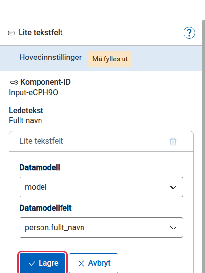

I **Oppsett** heter komponenten nå «Fullt navn».

{}
Altinn Studio lagrer oppsettet du har laget, i filer i appen. Komponenten står i layoutfilen for siden.
`textResourceBindings` viser hvilken tekst komponenten bruker som ledetekst (`title`), og `dataModelBindings` viser
hvilket felt i datamodellen appen lagrer svaret i.


App/ui/Task_1/layouts/om-innflytter.json


```json
{
  "dataModelBindings": {
    "simpleBinding": {
      "field": "person.fullt_navn",
      "dataType": "model"
    }
  },
  "id": "Input-eCPH9O",
  "type": "Input",
  "textResourceBindings": {
    "title": "om-innflytter.Input-eCPH9O.title.x2kt"
  }
}
```

Selve teksten ligger i tekstfilen for bokmål, med den samme ID-en som komponenten peker på:


App/config/texts/resource.nb.json


```json
{
  "id": "om-innflytter.Input-eCPH9O.title.x2kt",
  "value": "Fullt navn"
}
```

ID-ene slutter med tilfeldige tegn, så ID-ene i appen din blir annerledes.
{}

### Legge til resten av skjemafeltene

Du legger til resten av komponentene på samme måte som navnefeltet:

1. Hold musepekeren rett under komponenten som skal stå foran den nye komponenten, og klikk på **+**.
2. Velg komponenten. Finner du den ikke, klikker du på **Vis alle** og søker etter den.
3. Legg inn ledeteksten og velg datamodellfeltet.

Legg til disse komponentene i denne rekkefølgen, etter «Fullt navn»:

| Ledetekst     | Komponent      | Datamodellfelt        |
|---------------|----------------|-----------------------|
| Alder         | Lite tekstfelt | `person.alder`        |
| Gateadresse   | Lite tekstfelt | `adresse.gateadresse` |
| Postnummer    | Lite tekstfelt | `adresse.postnummer`  |
| Poststed      | Lite tekstfelt | `adresse.poststed`    |
| E-postadresse | Lite tekstfelt | `kontaktinfo.epost`   |
| Telefon       | Lite tekstfelt | `kontaktinfo.telefon` |
| Send inn      | Knapp          | Ingen                 |

Komponenten **Knapp** sender inn skjemaet når brukeren klikker på den. Den trenger derfor ingen kobling til
datamodellen.

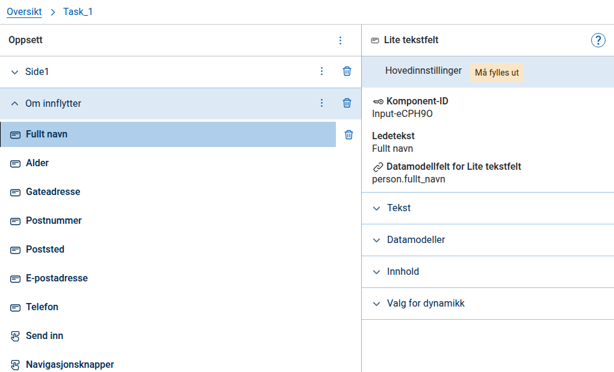

## Teste skjemaet

Forhåndsvisningen i Altinn Studio er midlertidig skrudd av. Klikker du på **Forhåndsvis**, ser du bare en melding om
dette.

For å teste hele flyten, også innsendingen, må du publisere appen til et testmiljø. Det lærer du i kurset
[Publiser og test en tjeneste]().

## Dele endringene

Del endringene dine på samme måte som tidligere. Klikk på **Del dine endringer**, beskriv endringene og klikk på
**Del endringer**.

Du har nå laget en app med

- navn, beskrivelse og kontaktinformasjon
- en velkomstside med logo og velkomsttekst
- en datamodell med gruppene `person`, `adresse` og `kontaktinfo`
- en skjemaside med sju felter og en knapp for å sende inn skjemaet

Du kan lese mer i [oversikten over komponentene du kan bruke i Altinn Studio]().
