# Lage et enkelt skjema

Altinn Studio – kom i gang

<!--
I dette kurset lager deltakerne sin første app i Altinn Studio. De starter med en tom app og ender med et skjema med to
sider. Senere kurs i serien bygger videre på appen de lager her.
-->

---
layout: default
---

# Dette lærer du

- Opprette en app og endre informasjonen om den
- Dele endringene dine
- Bygge en side med bilde og tekst
- Lage en enkel datamodell
- Bygge en skjemaside med felter koblet til datamodellen

<!--
Etter kurset kan deltakerne opprette en app og endre informasjonen om den, dele endringene sine slik at andre kan se
dem og de kan publisere dem, bygge en side med bilde og tekst, lage en enkel datamodell og bygge en skjemaside med
felter som er koblet til datamodellen.
-->

---
layout: default
---

# Dette skal du lage

Sogndal kommune vil ønske nye innbyggere velkommen og samle inn noen opplysninger om dem.

1. En velkomstside med logoen til kommunen og en kort velkomsttekst
2. En side der innflytteren fyller ut opplysninger om seg selv og sender inn skjemaet

<!--
Når noen melder flytting til kommunen, skal de få et enkelt skjema i Altinn. Deltakeren er tjenesteutvikler i
kommunen. Underveis i kurset får de en bestilling fra kommunen, og den skal de gjøre om til en datamodell og et skjema.
-->

---
layout: section
---

# Opprett en ny app

---
layout: two-cols
---

# Opprett en ny app

1. Klikk på **Opprett ny app** på dashbordet.
2. Velg organisasjonen din under **Eier**.
3. Skriv inn et navn under **Navn**, for eksempel `velkommen-til-sogndal`.
4. Velg **Altinn App v9 (preview)** under **Velg appversjon**.
5. Klikk på **Opprett app**.

::right::

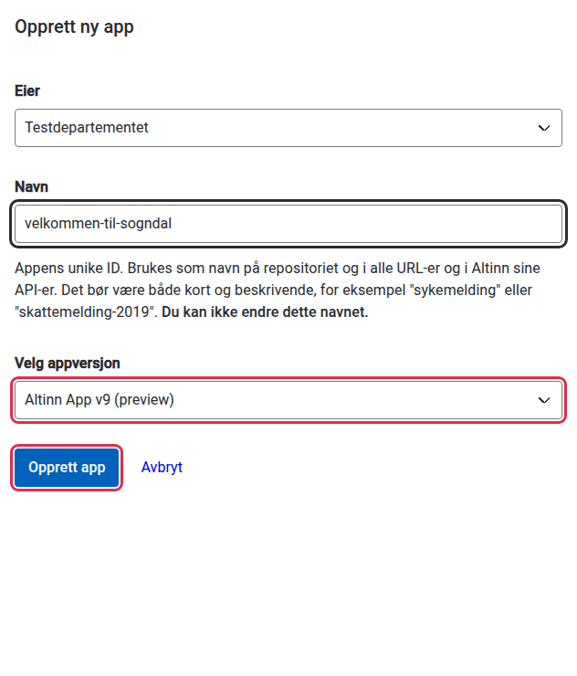

<!--
Hvis deltakeren lager appen på sin egen bruker, kan de ikke publisere den til et testmiljø senere.

Navnet må være unikt i organisasjonen. Altinn Studio bruker det også i nettadressen til tjenesten når den er
publisert. Navnet kan ikke endres senere.

Kurset er skrevet for apper på versjon 9. Vent til appen er opprettet før dere går videre.
-->

---
layout: section
---

# Endre informasjonen om appen

---
layout: default
---

# Oversiktssiden

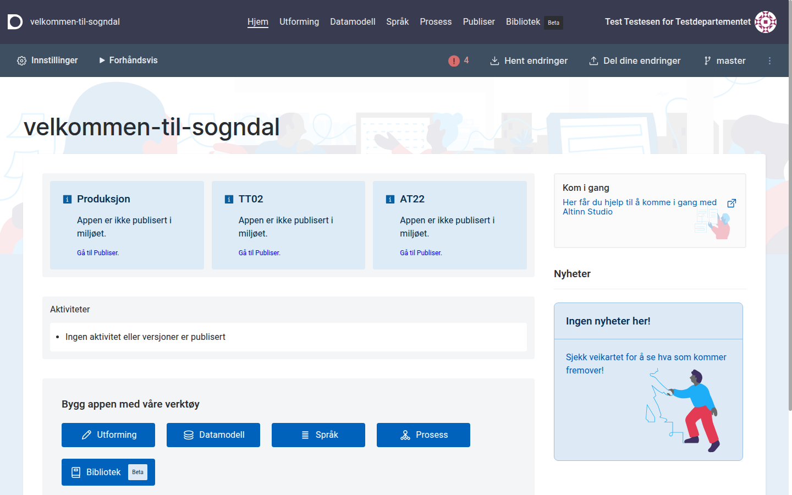

<!--
Når appen er opprettet, kommer deltakeren til oversiktssiden. Her ser de dette:

- Menylinjen: Her går du til verktøyene, som Utforming, Datamodell og Språk. Under menylinjen finner du blant annet
  Innstillinger, Forhåndsvis og Del dine endringer.
- Appens tittel: Brukeren ser tittelen inne i appen og i innboksen i Altinn. Til å begynne med er tittelen det samme
  som navnet på appen.
- Miljøer: Her ser du hvilke miljøer organisasjonen kan publisere apper til, for eksempel testmiljøet TT02 og
  produksjonsmiljøet.
- Kom i gang: Her finner du dokumentasjonen for Altinn Studio.
- Nyheter: Her publiserer vi informasjon om ny funksjonalitet.
-->

---
layout: two-cols
---

# Se hva som mangler

1. Klikk på varselsymbolet ved siden av **Hent endringer**.
2. Se hvilke feil du må rette opp.
3. Klikk på en feil for å gå rett til stedet der du retter den.

::right::

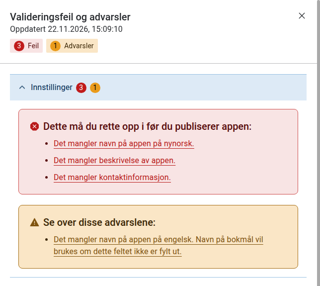

<!--
Tallet ved varselsymbolet viser hvor mange feil og advarsler appen har. Symbolet åpner Valideringsfeil og advarsler.

En ny app mangler navn på nynorsk, beskrivelse og kontaktinformasjon. Feilene må rettes opp før appen kan publiseres.
Advarslene kan deltakerne se bort fra i dette kurset.
-->

---
layout: default
---

# Legg inn navn, beskrivelse og kontaktinformasjon

1. Klikk på **Innstillinger**. Fanen **Om appen** åpnes.
2. Skriv inn **Navn på appen** på **Bokmål** og **Nynorsk**.
3. Skriv inn **Kort beskrivelse av appen** på **Bokmål** og **Nynorsk**.
4. Klikk på **Legg til ny kontakt**, fyll ut **E-postadresse** og **Tittel som beskriver hva det gjelder**, og klikk
   på **Lagre**.
5. Klikk på **Lagre** nederst på siden.
6. Klikk på **Til Hjem**.

<!--
Eksempel på navn: «Velkommen til Sogndal kommune», og på nynorsk «Velkomen til Sogndal kommune». Velg et navn som
brukerne forstår.

Beskrivelsen skal si hvem som skal bruke appen, og hva de skal bruke den til.

Eksempel på tittel for kontaktinformasjonen: «Kontakt kommunen».
-->

---
layout: default
---

# Om appen

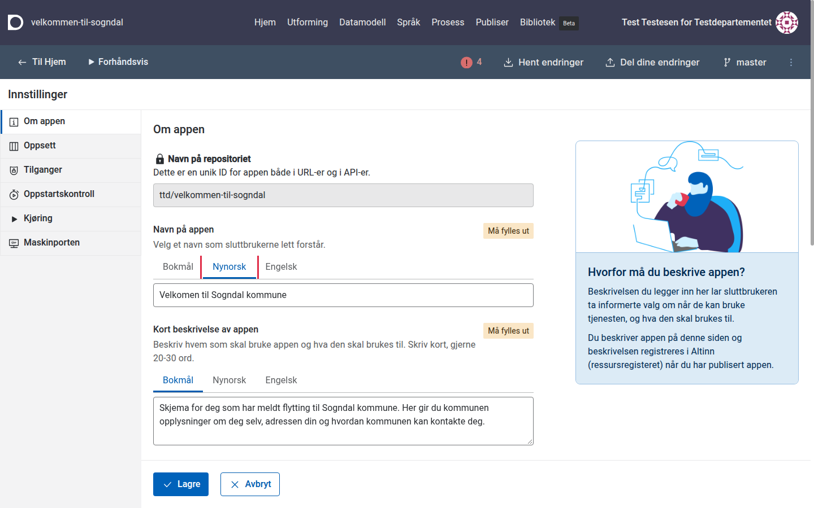

---
layout: default
---

# Ny tittel på oversiktssiden

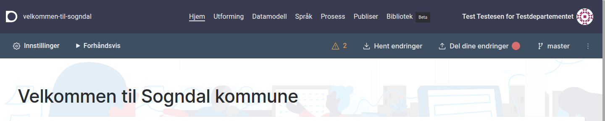

<!--
Tittelen på oversiktssiden er nå oppdatert. Varselsymbolet viser bare advarslene om at navn og beskrivelse mangler på
engelsk. Da bruker Altinn Studio teksten på bokmål.
-->

---
layout: section
---

# Lagre og dele endringer

---
layout: default
---

# To områder

- **Ditt eget område:** Altinn Studio lagrer endringene automatisk, og bare du ser dem
- **Appens sentrale område:** Alle som jobber med appen, ser endringene

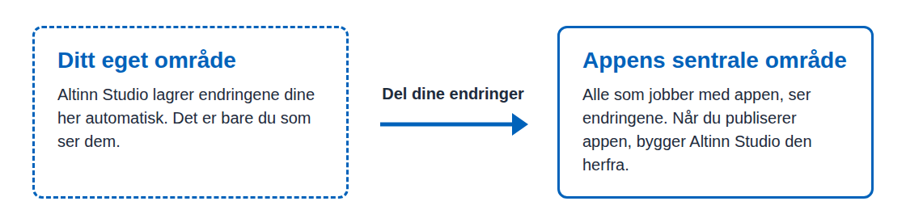

<!--
Når deltakeren publiserer appen, bygger Altinn Studio den fra appens sentrale område. Endringene må derfor deles før
de kan publiseres.

Når det finnes endringer som ikke er delt, står det en rød prikk ved Del dine endringer.
-->

---
layout: two-cols
---

# Del endringene

1. Klikk på **Del dine endringer**.
2. Klikk eventuelt på **Se siste endringer**, og lukk vinduet etterpå.
3. Beskriv endringene under **Beskriv endringene som er gjort**.
4. Klikk på **Del endringer**.

::right::

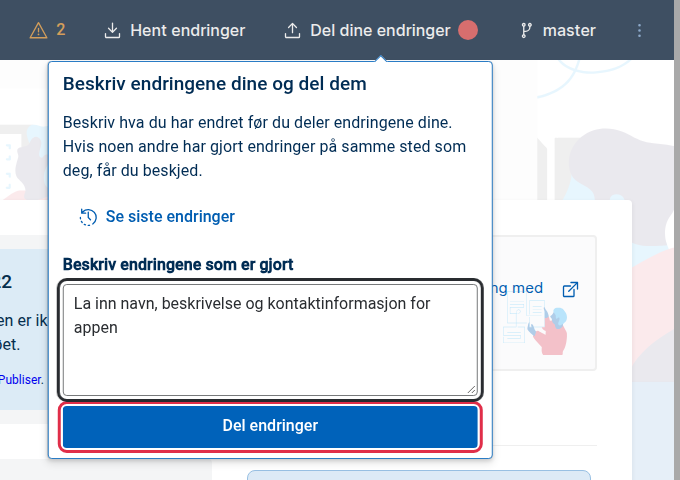

<!--
Eksempel på beskrivelse: «La inn navn, beskrivelse og kontaktinformasjon for appen».
-->

---
layout: section
---

# Lage velkomstsiden

---
layout: default
---

# Åpne Utforming

1. Klikk på **Utforming** i menylinjen.
2. Klikk på **Utform** på kortet for oppgaven **Task_1**.
3. Slå på bryteren **Prøv nytt design** øverst til høyre.

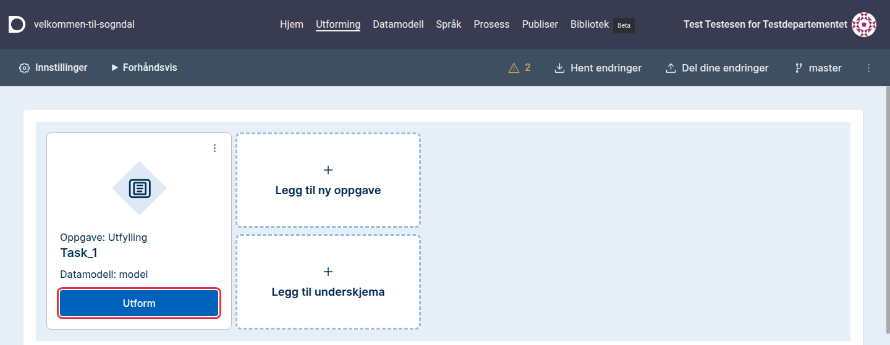

<!--
Velkomstsiden skal ha logoen til kommunen og en kort velkomsttekst.

Task_1 er utfyllingsoppgaven, der brukeren fyller ut skjemaet. Kurset bruker det nye designet for å legge til
komponenter.
-->

---
layout: default
---

# Slik er Utforming bygd opp

- **Oppsett:** sider og komponenter
- **Innstillinger:** siden eller komponenten du har valgt
- **Forhåndsvisning:** hvordan siden ser ut for brukeren

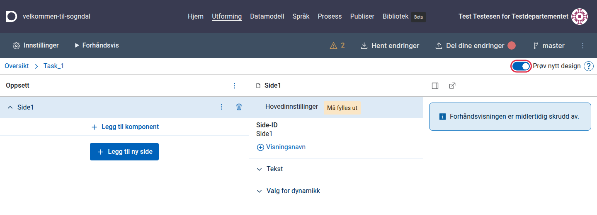

<!--
Forhåndsvisningen i Altinn Studio er midlertidig skrudd av. Deltakerne ser bare en melding om dette i stedet for
skjemaet.
-->

---
layout: two-cols
---

# Legg til et bilde

1. Klikk på siden **Side1**.
2. Klikk på **Legg til komponent**.
3. Bilde står ikke i listen. Klikk på **Vis alle**.

::right::

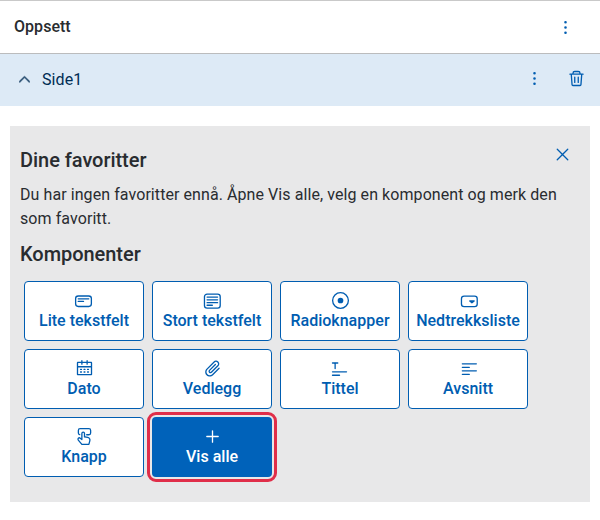

<!--
Listen viser de vanligste komponentene.
-->

---
layout: default
---

# Velg komponent

Søk etter «Bilde», klikk på **Bilde** under **Informasjon**, og klikk på **Legg til**.

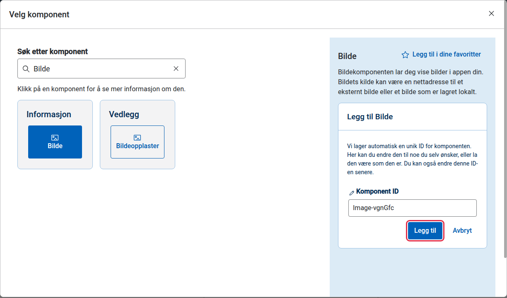

---
layout: two-cols
---

# Lim inn adressen

1. Klikk på fanen **Lim inn en URL** under **Valg for bilde**.
2. Klikk på **Lim inn bildeadressen (URL-en)** og lim inn adressen.
3. Klikk utenfor feltet for å lagre.

<div class="text-xs break-all mt-4">

https://docs.altinn.studio/nb/altinn-studio/v9/getting-started/development/basic-form/kommune-logo.png

</div>

::right::

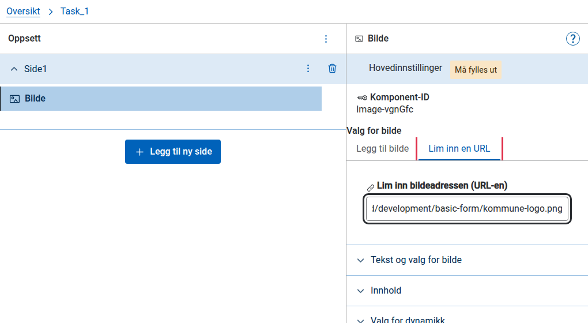

---
layout: two-cols
---

# Legg til et avsnitt

1. Hold musepekeren rett under **Bilde** i **Oppsett**.
2. Klikk på **+**.
3. Velg **Avsnitt**.

::right::

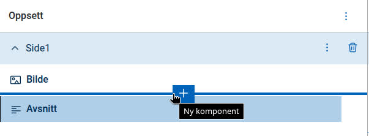

---
layout: two-cols
---

# Skriv velkomstteksten

1. Klikk på **Ledetekst**.
2. Skriv inn velkomstteksten under **Skriv tekst**.
3. Klikk på **Lagre**.

::right::

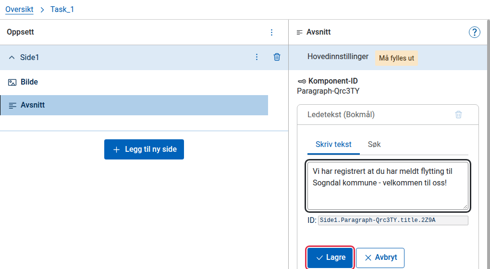

<!--
Eksempel på velkomsttekst: «Vi har registrert at du har meldt flytting til Sogndal kommune - velkommen til oss!»
-->

---
layout: default
---

# Den ferdige velkomstsiden

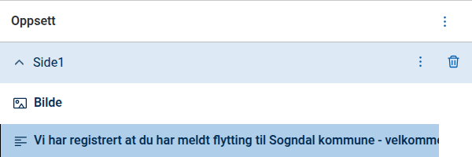

<!--
Velkomstsiden har nå et bilde og et avsnitt. I Oppsett ser deltakerne teksten i avsnittet.
-->

---
layout: section
---

# Sette opp datamodellen

---
layout: default
---

# Hva er en datamodell?

- En slags innholdsfortegnelse for skjemaet
- Bestemmer _hva_ du henter inn av data
- Bestemmer _hvordan_ dataene skal se ut

<!--
For et enkelt skjema er det ofte en direkte kobling mellom et felt i datamodellen og et felt i skjemaet. For mer
avanserte skjemaer kan datamodellen og skjemaet være ganske forskjellige.

Når du oppretter en app, følger det med en datamodell som heter model, med noen eksempelfelter. Du kan slette feltene,
gi dem nye navn og legge til egne felter.

Les mer i veiledningen om datamodellering:
https://docs.altinn.studio/nb/altinn-studio/v9/develop-a-service/reference/data/data-modeling/
-->

---
layout: default
---

# Krav fra kommunen

- **Personinformasjon:** fullt navn og alder
- **Adresse:** gateadresse, postnummer og poststed
- **Kontaktinformasjon:** e-postadresse og telefon

<!--
Deltakerne skal lage en gruppe for hver av de tre typene opplysninger. I datamodellen er en gruppe et objekt.
-->

---
layout: default
---

# Datamodellen du skal lage

| Gruppe (objekt) | Felt          | Type    |
|-----------------|---------------|---------|
| `person`        | `fullt_navn`  | Tekst   |
| `person`        | `alder`       | Heltall |
| `adresse`       | `gateadresse` | Tekst   |
| `adresse`       | `postnummer`  | Tekst   |
| `adresse`       | `poststed`    | Tekst   |
| `kontaktinfo`   | `epost`       | Tekst   |
| `kontaktinfo`   | `telefon`     | Tekst   |

---
layout: default
---

# Åpne datamodellen

Klikk på **Datamodell** i menylinjen, og sjekk at `model` er valgt.

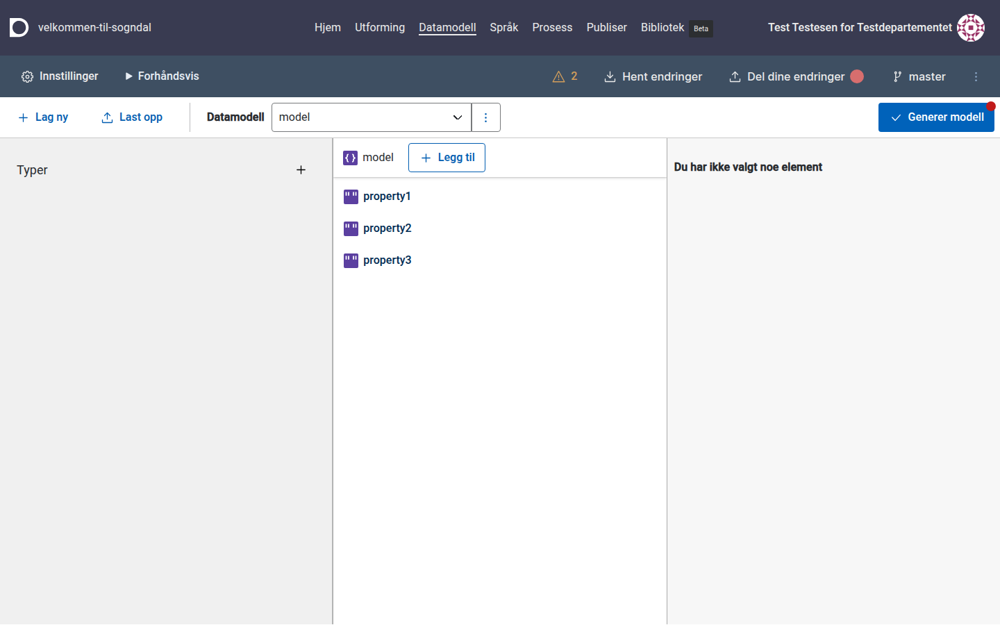

---
layout: default
---

# Slett eksempelfeltene

Hold musepekeren over feltet, klikk på søppelbøtteikonet og bekreft.

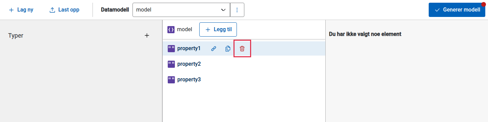

---
layout: default
---

# Lag den første gruppen

1. Klikk på **Legg til** og velg **Objekt**.
2. Endre **Navn** til `person` under **Egenskaper**.
3. Klikk på **Legg til felt** og velg **Legg til tekst**.
4. Endre **Navn** til `fullt_navn`.

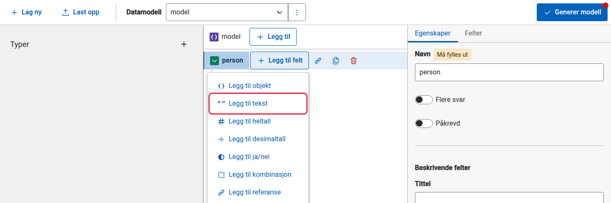

---
layout: default
---

# Gjør ferdig datamodellen

1. Legg til resten av gruppene og feltene. `alder` legger du til med **Legg til heltall**.
2. Klikk på **Generer modell**.

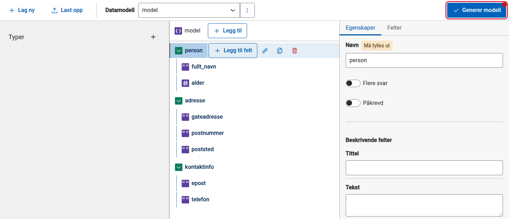

<!--
Når deltakerne klikker på Generer modell, lager Altinn Studio filene appen trenger for datamodellen, og viser en
melding når det er gjort.
-->

---
layout: default
---

# Del endringene

Klikk på **Del dine endringer**, beskriv endringene og klikk på **Del endringer**.

---
layout: section
---

# Utforme skjemasiden

<!--
Nå skal deltakerne bygge selve skjemaet. De gjør det nesten på samme måte som da de laget velkomstsiden. Åpne Utforming
og klikk på Utform på kortet for oppgaven Task_1.
-->

---
layout: two-cols
---

# Lag en ny side

1. Klikk på **Legg til ny side**.
2. Klikk på **Side-ID**, skriv `om-innflytter` og klikk på **Lagre**.
3. Klikk på **Visningsnavn**, skriv «Om innflytter» og klikk på **Lagre**.

::right::

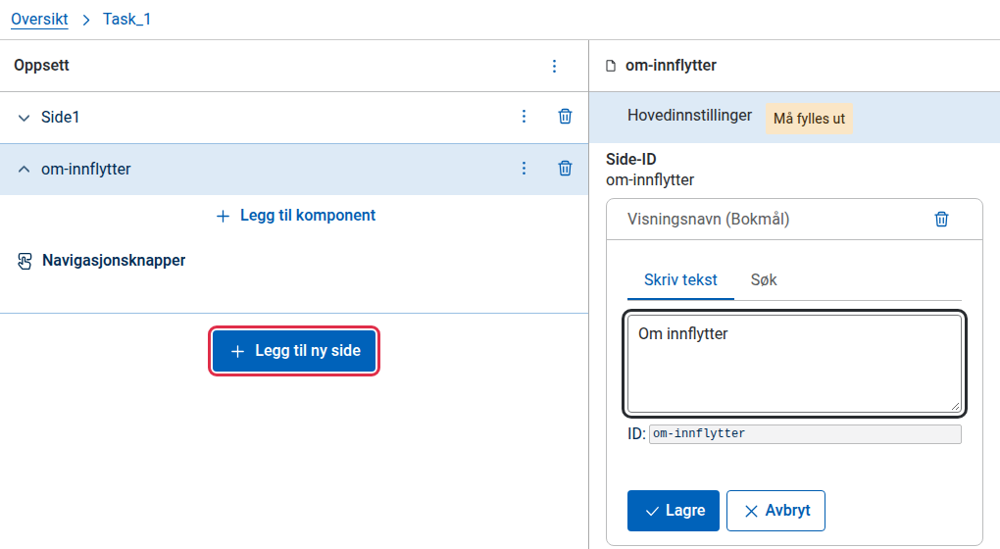

<!--
Den nye siden heter først «Side2».

Altinn Studio legger automatisk til komponenten Navigasjonsknapper på begge sidene. Da kan brukeren bla mellom sidene
med knappene Neste og Forrige.
-->

---
layout: default
---

# Legg til det første skjemafeltet

1. Klikk på **Legg til komponent** på siden **om-innflytter**.
2. Klikk på **Lite tekstfelt**.

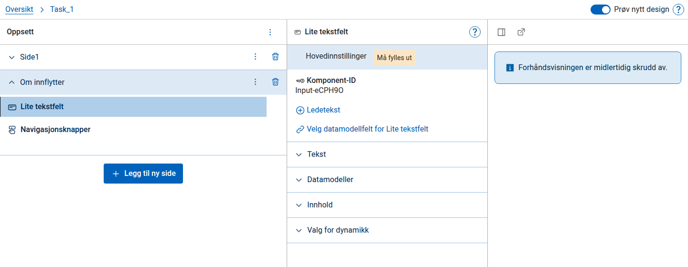

<!--
Det første feltet skal samle inn navnet til innflytteren. Lite tekstfelt er en komponent der brukeren skriver inn en
kort tekst på én linje.

Komponenten står nå på siden, foran navigasjonsknappene. Den mangler en ledetekst og en kobling til datamodellen.
-->

---
layout: default
---

# Tekster og tekst-ID-er

- Ledeteksten står over feltet og forteller brukeren hva de skal fylle inn
- Alle tekstene ligger i en egen tekstfil, og hver tekst har en unik ID
- Komponenten peker på ID-en, ikke på selve teksten

<!--
Derfor kan du bruke samme tekst flere steder, endre teksten uten å endre komponenten og oversette teksten til nynorsk
og engelsk under Språk i menylinjen.
-->

---
layout: two-cols
---

# Legg inn ledeteksten

1. Sjekk at **Lite tekstfelt** er valgt.
2. Klikk på **Ledetekst**.
3. Skriv «Fullt navn» under **Skriv tekst**.
4. Klikk på **Lagre**.

::right::

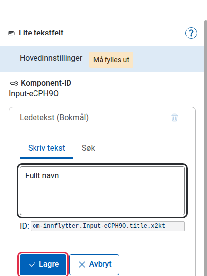

<!--
Altinn Studio lager ID-en for teksten automatisk.

Vil du bruke en tekst som allerede finnes i appen, klikker du på Søk og velger teksten fra listen.
-->

---
layout: two-cols
---

# Knytt feltet til datamodellen

1. Klikk på **Velg datamodellfelt for Lite tekstfelt**.
2. Velg `person.fullt_navn` under **Datamodellfelt**.
3. Klikk på **Lagre**.

::right::

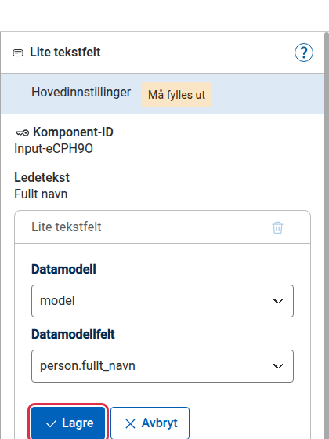

<!--
Når brukeren fyller ut skjemaet, må appen lagre svaret et sted. Det er datamodellen som bestemmer hvor. Hvert skjemafelt
knyttes til et felt i datamodellen, slik at svaret havner på riktig sted.

Under Datamodell er model allerede valgt. I Oppsett heter komponenten nå «Fullt navn».
-->

---
layout: default
---

# Fordypning: navnefeltet i filene til appen

`App/ui/Task_1/layouts/om-innflytter.json`

```json
{
  "dataModelBindings": {
    "simpleBinding": { "field": "person.fullt_navn", "dataType": "model" }
  },
  "id": "Input-eCPH9O",
  "type": "Input",
  "textResourceBindings": { "title": "om-innflytter.Input-eCPH9O.title.x2kt" }
}
```

`App/config/texts/resource.nb.json`

```json
{ "id": "om-innflytter.Input-eCPH9O.title.x2kt", "value": "Fullt navn" }
```

<!--
Valgfritt lysbilde.

Altinn Studio lagrer oppsettet i filer i appen. Komponenten står i layoutfilen for siden. textResourceBindings viser
hvilken tekst komponenten bruker som ledetekst (title), og dataModelBindings viser hvilket felt i datamodellen appen
lagrer svaret i. Selve teksten ligger i tekstfilen for bokmål, med den samme ID-en.

ID-ene slutter med tilfeldige tegn, så ID-ene i appen til deltakerne blir annerledes.
-->

---
layout: default
---

# Legg til resten av skjemafeltene

1. Hold musepekeren rett under komponenten som skal stå foran, og klikk på **+**.
2. Velg komponenten. Finner du den ikke, klikker du på **Vis alle** og søker.
3. Legg inn ledeteksten og velg datamodellfeltet.

---
layout: default
---

# Komponentene etter «Fullt navn»

| Ledetekst     | Komponent      | Datamodellfelt        |
|---------------|----------------|-----------------------|
| Alder         | Lite tekstfelt | `person.alder`        |
| Gateadresse   | Lite tekstfelt | `adresse.gateadresse` |
| Postnummer    | Lite tekstfelt | `adresse.postnummer`  |
| Poststed      | Lite tekstfelt | `adresse.poststed`    |
| E-postadresse | Lite tekstfelt | `kontaktinfo.epost`   |
| Telefon       | Lite tekstfelt | `kontaktinfo.telefon` |
| Send inn      | Knapp          | Ingen                 |

<!--
Komponenten Knapp sender inn skjemaet når brukeren klikker på den. Den trenger derfor ingen kobling til datamodellen.
-->

---
layout: default
---

# Den ferdige skjemasiden

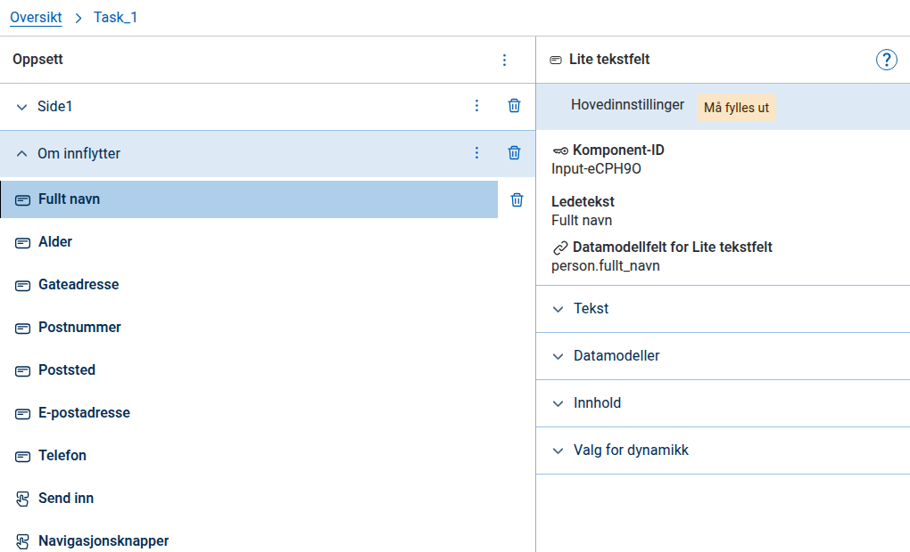

---
layout: default
---

# Teste skjemaet

- Forhåndsvisningen i Altinn Studio er midlertidig skrudd av
- For å teste hele flyten må du publisere appen til et testmiljø
- Det lærer du i kurset «Publiser og test en tjeneste»

<!--
Klikker deltakerne på Forhåndsvis, ser de bare en melding om at forhåndsvisningen er skrudd av.

Kurset om publisering:
https://docs.altinn.studio/nb/altinn-studio/v9/getting-started/development/publish/
-->

---
layout: default
---

# Del endringene

Klikk på **Del dine endringer**, beskriv endringene og klikk på **Del endringer**.

---
layout: default
---

# Du har laget en app med

- navn, beskrivelse og kontaktinformasjon
- en velkomstside med logo og velkomsttekst
- en datamodell med gruppene `person`, `adresse` og `kontaktinfo`
- en skjemaside med sju felter og en knapp for å sende inn skjemaet

<!--
Neste kurs: Publiser og test en tjeneste.

Oversikt over komponentene du kan bruke i Altinn Studio:
https://docs.altinn.studio/nb/altinn-studio/v9/develop-a-service/look-and-feel/components/
-->

---
layout: end
---

# Neste kurs: Publiser og test en tjeneste
